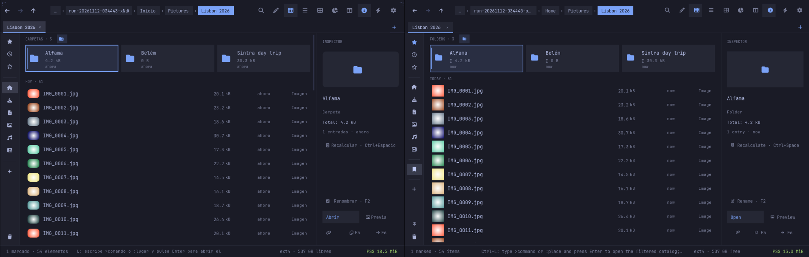
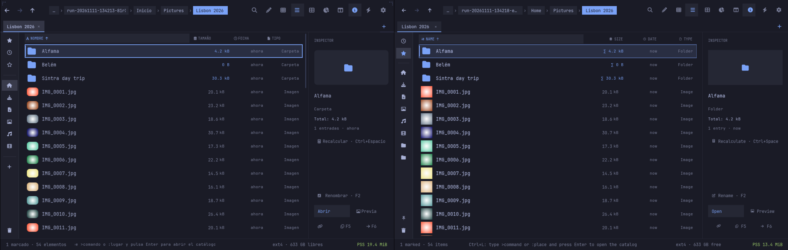
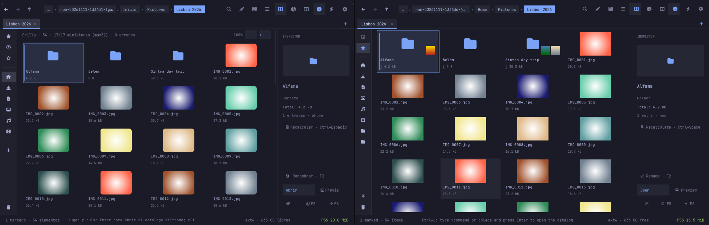
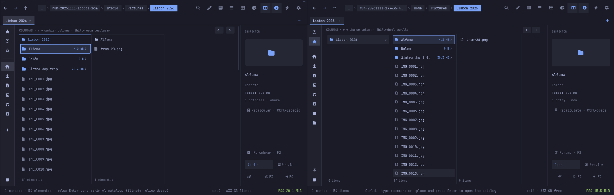
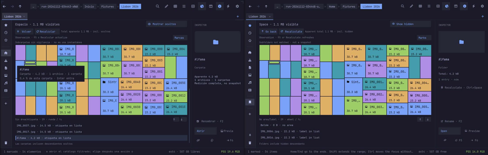
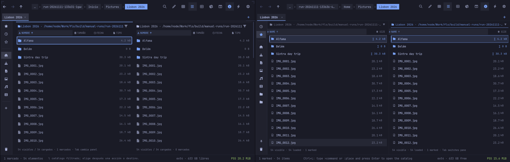
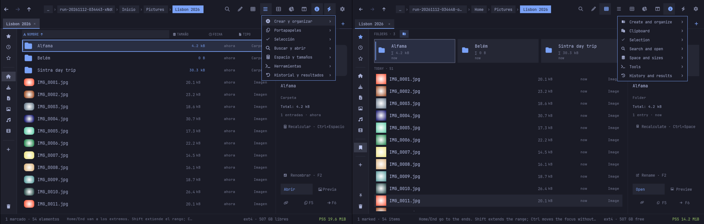
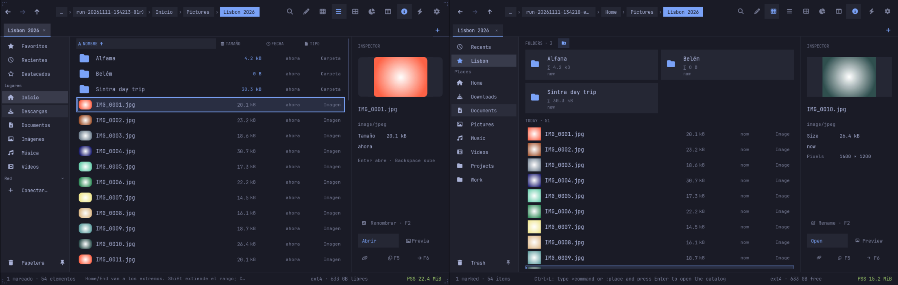

# Flo

**F**ile manager, **L**ight, l**O**w memory.

Flo is the C++ successor of **Files**
([avillagran/files-rust](https://github.com/avillagran/files-rust)), the
Rust file manager for Omarchy, and keeps Files' identity: its window
(header with path chips and compact view buttons, tab strip, 52 px rail,
inspector, status bar), its views (Groups, List, Grid, Columns and the Space
treemap), its keys and its wording. Flo rebuilds it in plain C++17 on
[FLTK](https://www.fltk.org) 1.4 to start fast, stay small and build in
seconds.



## From Rust to C++

Files proved that a full file manager fits in about 19 MiB, but each Rust
project carried gigabytes of build output and long release builds. Flo
keeps the app and drops the weight: CMake, a build folder of a few
megabytes, FLTK linked statically.

Its toolkit moved the same way:
[avillagran/lib-fltk-omarchy](https://github.com/avillagran/lib-fltk-omarchy)
(C++), from
[lib-fltk-omarchy-rust](https://github.com/avillagran/lib-fltk-omarchy-rust),
whose look (Files' look) it carries.

For desktop standards and plumbing (the freedesktop thumbnail cache and
trash, GTK bookmarks, Recents, `org.freedesktop.FileManager1`, GVfs/SFTP and
the tailnet, MTP) Flo follows Omarchy's
[Folio](https://github.com/omacom/folio). Folio is a technical reference
only: look, layout, keys and wording are Files'.

## Status

Usable, with Files' everyday features; see
[docs/FILES-PARITY.md](docs/FILES-PARITY.md) for what is done, what comes
next and what is left out of this phase.

- **Window** (`src/ui/`, on the
  [lib-fltk-omarchy](https://github.com/avillagran/lib-fltk-omarchy)
  toolkit): Files' header (back/forward/up, path chips, Search, Edit path,
  Groups, List, Grid, Space, Columns, Inspector, Actions, Preferences; a
  label on hover, the shortcut after a rest), tabs (Ctrl+T, Ctrl+W,
  Ctrl+Shift+T, Ctrl+Tab), the expandable rail (Files' places and
  bookmarks, reordered by dragging, Recents, drives with eject, the
  Network section with "Connect…", connected locations and tailnet
  machines, the trash), the views
  (Ctrl+1 Groups, 2 List, 3 Columns, 4 Space, 5 Grid), the inspector
  (Ctrl+Alt+I) with automatic folder sizes (Ctrl+Space recalculates), the
  status bar with live PSS, type-to-filter (`*.pdf`, `ext:md`, `type:dir`,
  `!draft`), the omnibar (Ctrl+L: a path, `>command` or `:place`), the
  commands palette (Ctrl+Shift+P), recursive search (Ctrl+Shift+F), the dual
  pane (F9, F5/F6 to the other pane), Actions (F10) and Preferences
  (Ctrl+,) menus, the context menu, Insert / Ctrl+I / Ctrl+Shift+A
  selection tools, F2 rename, F7 new folder, Ctrl+N new file, drag and
  drop, the SFTP password prompt, file operations with progress, conflict
  prompts and undo, and F1 for every shortcut. The live Omarchy theme and
  font (a Nerd Font for the glyph icons) apply throughout.
- **Preview** (Space) runs as its own process, `flo preview PATH`, so
  decoding a large picture never grows the main window.
- **flo-core** (`src/core/`, no FLTK): folder listing off the UI thread
  with natural order, live reload, Files' name filter, folder sizes without
  following links, search (plocate, then a live walk), the shared
  freedesktop thumbnail cache with sandboxed `flo-thumbnailer` workers, file
  operations that never overwrite (copy, move, paste, duplicate, rename, new
  folder, compress, extract) with undo and redo, the freedesktop trash,
  GNOME/KDE clipboard formats, places (Home and the XDG folders, GTK bookmarks,
  Recents, drives), tailnet machines over SFTP, Dropbox status,
  `org.freedesktop.FileManager1`, and settings.
- **CLI** for scripts and agents, no display needed:
  `flo list|info|thumbnail|trash|restore [--json] PATH`.

See [docs/CORE.md](docs/CORE.md), [docs/THUMBNAILS.md](docs/THUMBNAILS.md)
and [docs/FILES-PARITY.md](docs/FILES-PARITY.md).

Files (left) and Flo (right), from
[docs/screenshots/files-vs-flo/](docs/screenshots/files-vs-flo/):

| | |
|---|---|
| List |  |
| Grid |  |
| Columns |  |
| Space |  |
| Dual pane (F9) |  |
| Actions (F10) |  |
| Rail |  |

More of Flo alone in [docs/screenshots/](docs/screenshots/): drives and
network, the SFTP prompt, rename, conflict, trash, undo, empty folder,
shortcuts and the preview.

## Memory

PSS and RSS from `/proc/PID/smaps_rollup` (`tools/measure-mem.sh`), release
build, FLTK linked statically, in a private Xvfb (1100x700 window, X11
backend, no session bus), Tokyo Night, with the fixture home of
`tools/gui-session.sh` (a folder of 50 photos, 1600x1200 JPEG). Measured
2026-11-11 before (5b0724c, the Folio-look window) and after the Files
look, in the same session:

| State | before | after |
|---|---|---|
| Home folder, idle | 13.5 MiB | 14.6 MiB |
| Photo folder, first screen of thumbnails (Groups after; grid before) | 15.8 MiB | 15.0 MiB |
| Same folder in the Grid view | — | 16.3 MiB |
| After the Grid and 30 s idle in Groups | — | 16.6 MiB |

Files itself, in the same states and session, shows 19 to 22 MiB in its
own PSS footer. The new window costs about 1 MiB at rest (the tab strip,
rail, inspector, status bar and the folder-size worker) and nothing in a
folder of photos, where the 38 px rows draw smaller thumbnails than the
old grid. Text uses one face of the Nerd Font: a second (bold) face would
add about 0.5 MiB. Scaled thumbnails are capped at 4 MiB (about 115
tiles), so a bigger folder of photos doesn't grow past that.

Reported separately (child processes, gone when idle):

| Process | PSS | RSS |
|---|---|---|
| `flo-thumbnailer` worker, while making thumbnails (up to 4; exit after 20 s idle) | ~1.0 MiB each | ~7.7 MiB each |
| `flo preview` showing a 1600x1200 photo (exits when closed) | 23.7 MiB | 40.5 MiB |

For reference: a bare FLTK window is about 9 MiB.

## Building

Requires CMake 3.16+, a C++17 compiler, GLib/GIO, libpng and libjpeg-turbo,
plus `bsdtar` (libarchive) at runtime for compress and extract. FLTK 1.4 is
a build-time dependency only: the `flo` binary links `libfltk.a` statically
by default, so the fltk package isn't needed at runtime
(`-DFLO_SHARED_FLTK=ON` links the shared library instead).

```sh
git submodule update --init
cmake -S . -B build -DCMAKE_BUILD_TYPE=Release
cmake --build build
ctest --test-dir build
```

To install as a package, `cd packaging && makepkg -si` (desktop entry for
`inode/directory`, icon, `flo` and `flo-thumbnailer`). The package builds
cleanly with `BUILDDIR`, `PKGDEST` and `SRCDEST` pointing into `build/`
(checked 2026-11-11: a 1.5 MiB `flo-0.1.0-1-x86_64.pkg.tar.zst` with all
translations, FLTK
linked statically, every library the binaries load covered by `depends`).

### Checking the window

`tools/gui-session.sh start` runs Flo in a private Xvfb inside bubblewrap
with fixture data (a home with 50 photos) and prints the run directory;
`tools/xdrive.py` sends keys and clicks and takes screenshots there, and
`tools/gui-session.sh stop RUN_DIR` stops it. Nothing touches your home.
`FLO_SESSION_SETUP=tools/session-fixtures.sh` adds a removable drive, an
SFTP stand-in, fake `tailscale`/`dropbox-cli`/`localsend` that only log,
and private applications; `FLO_SESSION_BUS=1` gives the session a private
D-Bus for `org.freedesktop.FileManager1`. `FLO_SESSION_APP` runs another
binary in the same kind of session (Files, for comparisons) and
`FLO_SESSION_THEME` copies an Omarchy `colors.toml` in.
`tools/side-by-side.sh FILES_BINARY COLORS_TOML` takes the Files/Flo pairs
in `docs/screenshots/files-vs-flo/`, `tools/flo-shots.sh COLORS_TOML` the
rest.

Tests run in a fresh private directory under `build/test-runs/` with their
own `HOME`, `TMPDIR` and XDG directories; they never touch your files.

## License

MIT. See [LICENSE](LICENSE).
