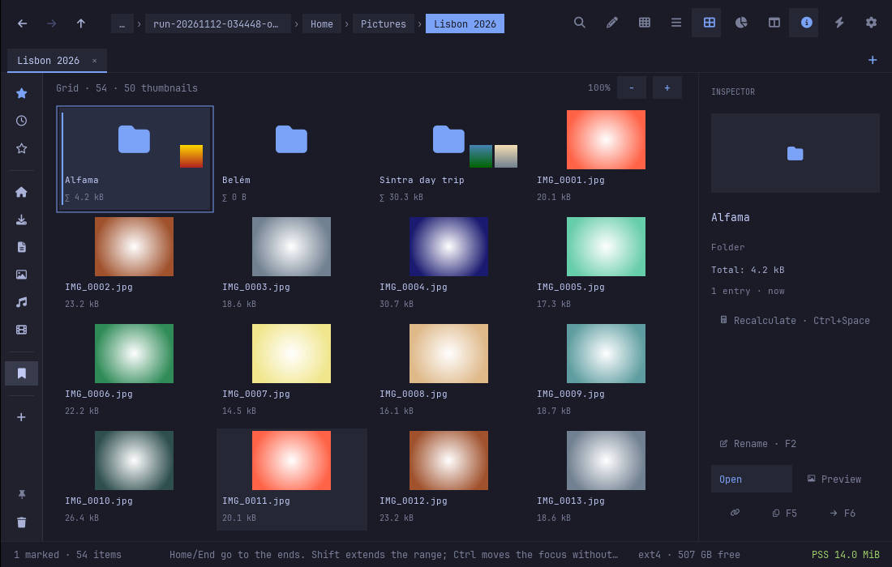
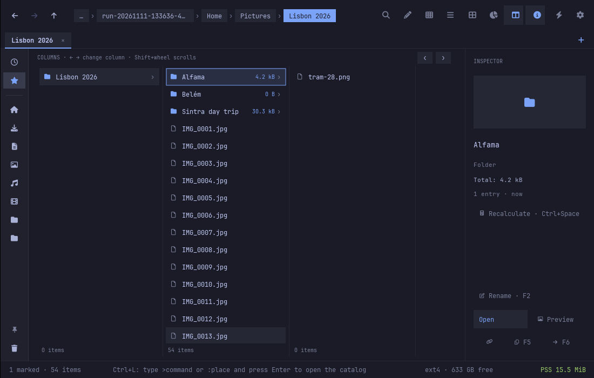
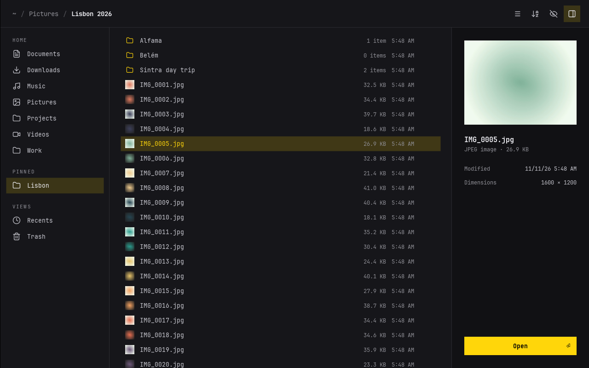
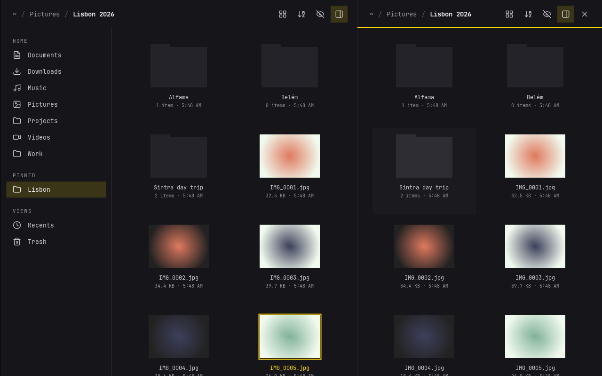
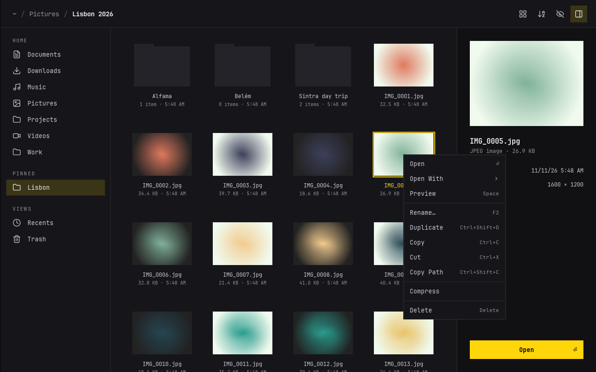
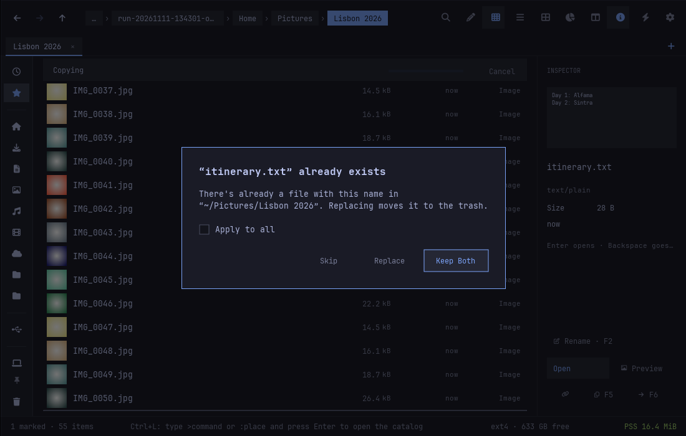

# Flo

**F**ile manager, **L**ight, l**O**w memory.

Flo is a lightweight file manager for Omarchy. It follows the patterns and
standards of [Folio](https://github.com/omacom/folio), Omarchy's own file
manager: the same keys, the same shared thumbnail cache, GTK bookmarks and
recent files, the freedesktop trash, and nothing running in the background.
Flo's goal is to do that with as little memory as possible, using
[FLTK](https://www.fltk.org) instead of Qt Quick.

## From Rust to C++

Flo is the C++ rewrite of
[avillagran/files-rust](https://github.com/avillagran/files-rust), the
original project, a Rust file manager built on fltk-rs. The Rust version
proved that a full file manager fits in about 19 MiB, but each Rust project
carried gigabytes of build output and long release builds. Flo keeps the
goal and drops the weight: plain C++17 on FLTK 1.4, built with CMake into a
build folder of a few megabytes.

Its toolkit moved the same way:
[avillagran/lib-fltk-omarchy](https://github.com/avillagran/lib-fltk-omarchy)
(C++), from
[lib-fltk-omarchy-rust](https://github.com/avillagran/lib-fltk-omarchy-rust).

## Status

Usable. The window covers Folio's everyday behavior; see
[docs/FOLIO-PARITY.md](docs/FOLIO-PARITY.md) for what is still missing.

- **Window** (`src/ui/`, on the
  [lib-fltk-omarchy](https://github.com/avillagran/lib-fltk-omarchy)
  toolkit): sidebar (home folders, pins from GTK bookmarks, Recents, Trash,
  drives with eject, tailnet machines), breadcrumbs, grid (256 px
  thumbnails), list and columns views (Ctrl+1/2/3), details pane (Ctrl+I),
  split view (Ctrl+Alt+N, Ctrl+W), path entry with Tab completion (Ctrl+L),
  `/` search, context menu (right click, Alt+Enter, Menu), drag and drop,
  the SFTP password prompt in the window, file operations with progress and
  conflict prompts, undo/redo toasts, `?` shortcuts overlay, and Folio's keys.
  The live Omarchy theme and the toolkit's motion apply throughout.
- **Preview** (Space) runs as its own process, `flo preview PATH`, so
  decoding a large picture never grows the main window.
- **flo-core** (`src/core/`, no FLTK): folder listing off the UI thread with
  Folio's sort modes and natural order, live reload, `/` search, the shared
  freedesktop thumbnail cache with sandboxed `flo-thumbnailer` workers, file
  operations that never overwrite (copy, move, paste, duplicate, rename, new
  folder, compress, extract) with undo and redo, the freedesktop trash,
  GNOME/KDE clipboard formats, places (home folders, GTK bookmarks, Recents,
  drives with mount/unmount/eject), tailnet machines over SFTP and Dropbox
  status, `org.freedesktop.FileManager1`, and settings.
- **CLI** for scripts and agents, no display needed:
  `flo list|info|thumbnail|trash|restore [--json] PATH`.

See [docs/CORE.md](docs/CORE.md), [docs/THUMBNAILS.md](docs/THUMBNAILS.md)
and [docs/FOLIO-PARITY.md](docs/FOLIO-PARITY.md).

| Grid | Columns |
|---|---|
|  |  |
|  |  |
|  |  |

More in [docs/screenshots/](docs/screenshots/): search, path entry, rename,
preview, trash, undo toast, empty folder, shortcuts overlay.

## Memory

PSS and RSS from `/proc/PID/smaps_rollup` (`tools/measure-mem.sh`), after
30 seconds idle, release build, FLTK linked statically, in a private Xvfb
(1280x800 window, X11 backend, no session bus), with a folder of 50 photos
(1600x1200 JPEG) open in the grid with the details pane. Measured
2026-11-11 with folder peeks, remembered listings and all 50 translation
catalogs in the binary:

| State | flo PSS | flo RSS |
|---|---|---|
| Folder open, first screen of thumbnails, cold cache | 16.1 MiB | 31.1 MiB |
| Same, restarted with a warm thumbnail cache | 15.5 MiB | 30.1 MiB |
| After scrolling through all 50 thumbnails | 20.7 MiB | 36.1 MiB |

The previous release (eeac41a), measured in the same session for
comparison, gave 16.2 MiB and 20.7 MiB for the first and third rows (its
earlier 15.7 and 19.2 MiB were taken on a different day): the new
features cost about 0.3 to 0.5 MiB, and a fixed malloc mmap threshold
(decoded thumbnails no longer fragment the heap) wins back about 0.7 MiB.
Scaled thumbnails are capped at 4 MiB (about 115 tiles), so a bigger
folder of photos doesn't grow past that.

Reported separately (child processes, gone when idle):

| Process | PSS | RSS |
|---|---|---|
| `flo-thumbnailer` worker, while making thumbnails (up to 4; exit after 20 s idle) | ~1.0 MiB each | ~7.9 MiB each |
| `flo preview` showing a 1600x1200 photo (exits when closed) | 23.7 MiB | 40.5 MiB |

For reference: the Rust predecessor measured 19 MiB, a bare FLTK window
about 9 MiB.

## Building

Requires CMake 3.16+, a C++17 compiler, GLib/GIO, libpng and libjpeg-turbo,
plus `bsdtar` (libarchive) at runtime for compress and extract. FLTK 1.4 is
a build-time dependency only: the `flo` binary links `libfltk.a` statically
by default, so the fltk package isn't needed at runtime
(`-DFLO_SHARED_FLTK=ON` links the shared library instead).

```sh
git submodule update --init
cmake -S . -B build -DCMAKE_BUILD_TYPE=Release
cmake --build build
ctest --test-dir build
```

To install as a package, `cd packaging && makepkg -si` (desktop entry for
`inode/directory`, icon, `flo` and `flo-thumbnailer`). The package builds
cleanly with `BUILDDIR`, `PKGDEST` and `SRCDEST` pointing into `build/`
(checked 2026-11-11: a 1.5 MiB `flo-0.1.0-1-x86_64.pkg.tar.zst` with all
translations, FLTK
linked statically, every library the binaries load covered by `depends`).

### Checking the window

`tools/gui-session.sh start` runs Flo in a private Xvfb inside bubblewrap
with fixture data (a home with 50 photos) and prints the run directory;
`tools/xdrive.py` sends keys and clicks and takes screenshots there, and
`tools/gui-session.sh stop RUN_DIR` stops it. Nothing touches your home.
`FLO_SESSION_SETUP=tools/session-fixtures.sh` adds a removable drive, an
SFTP stand-in, fake `tailscale`/`dropbox-cli`/`localsend` that only log,
and private applications; `FLO_SESSION_BUS=1` gives the session a private
D-Bus for `org.freedesktop.FileManager1`.

Tests run in a fresh private directory under `build/test-runs/` with their
own `HOME`, `TMPDIR` and XDG directories; they never touch your files.

## License

MIT. See [LICENSE](LICENSE).
